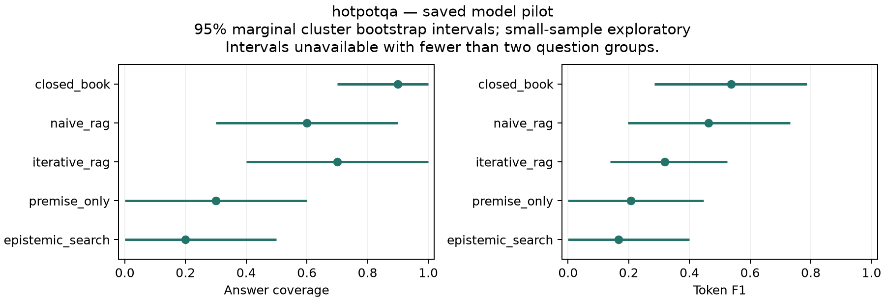

# Epistemic Search: An Inspectable Premise-Aware Retrieval System and a Small Negative Pilot

Technical report · October 2026 · Implementation and exploratory evaluation

## Abstract

We implement retrieval control over an explicit premise graph, a provenance-backed
evidence ledger and separate supported, contradicted, mixed and unknown states.
A conservative reasoner identifies unresolved obligations; a bounded controller
retrieves more evidence, attempts conflict resolution, answers or abstains. We
compare the system with closed-book, fixed-retrieval, iterative-retrieval and
premise-only baselines using the same model, reasoning setting, retriever and
resource ceilings. On small saved HotpotQA and 2WikiMultiHopQA pilots, the full
system does not establish an adjusted advantage over naive RAG and exhibits low
answer coverage. ConfRAG diagnostics expose a missed conflict and extraction
failures. These observations support a reproducible engineering artifact and a
negative pilot report, not a claim of improved reliability, calibrated uncertainty
or architectural novelty. All result tables are generated from saved scores;
failed cases remain visible. Wider evaluation is deferred until semantic
extraction and the experimental design have independent validation.

## 1. Motivation and contribution boundary

Relevance alone does not establish that the evidence needed for an answer has
been acquired. We investigate an explicit representation of that gap: which
premise remains unresolved, what evidence bears on it, and whether the next
retrieval is worth its cost. The intended benefit is a better reliability and
resource tradeoff. The present experiment does not establish that benefit.

The delivered contributions are an instrumented implementation with mockable
provider boundaries, matched baseline execution, transparent failure records and
an offline reproduction package. We distinguish implemented capabilities from
empirically validated claims. The local trace dashboard supports inspection; it
is not the scientific contribution. The original proposal remains a record of
hypotheses, rather than a description of demonstrated results.

## 2. Related work and overlap

Active and adaptive retrieval are established: [FLARE](https://arxiv.org/abs/2305.06983)
uses predicted continuation content to drive retrieval; [Self-RAG](https://arxiv.org/abs/2310.11511)
learns retrieval/reflection behavior; [Adaptive-RAG](https://arxiv.org/abs/2403.14403)
selects retrieval strategies using question complexity. Our simple iterative
baseline is an internal control, not a faithful reproduction of these systems.

The closest conceptual neighbors are [S2G-RAG](https://arxiv.org/abs/2604.23783),
which uses explicit sufficiency/gap judgments and compact evidence, and
[Socrates-RAG](https://arxiv.org/abs/2609.35773), which selects unresolved premises
to discriminate competing answers under a finite search budget. Neither gap
retrieval nor premise-directed inquiry is introduced by this project.

[Abstention-Aware Scientific Reasoning](https://arxiv.org/abs/2602.14189) combines
condition decomposition, evidence auditing and selective decisions.
[Semantic Entropy](https://www.nature.com/articles/s41586-024-07421-0) measures
uncertainty over meanings; our heuristic evidence scores are not that estimator
and are not calibrated probabilities. [Logic-LM](https://arxiv.org/abs/2305.12295)
and [LINC](https://aclanthology.org/2023.emnlp-main.313/) already combine semantic
translation with symbolic inference.

Information-value ideas also overlap: [InfoGain-RAG](https://aclanthology.org/2025.emnlp-main.365/)
ranks and filters documents using information gain; [ECR](https://arxiv.org/abs/2603.28444)
proposes claim acquisition through expected entropy reduction; and
[DeepControl](https://arxiv.org/abs/2602.01672v3) controls evidence acquisition and
granularity through information utility. The non-peer-reviewed
[Evidence-Obligation PGR preprint](https://www.preprints.org/manuscript/202607.1060)
also describes an obligation ledger and warrant gate. These overlaps narrow our
position to an implementation and evaluation snapshot. The targeted primary-source
audit is documented in [the literature map](../../LITERATURE_MAP.md); it is not an
exhaustive full-text review or evidence that the combined architecture is novel.

## 3. Method

The state contains a validated directed acyclic premise graph, evidence items,
claim beliefs, a derivation/blocker trace and cumulative resource use. Structured
model outputs must pass schemas. Extracted spans must occur in their cited source;
source IDs, queries and evidence identifiers remain attached to the record.
Duplicate evidence is compacted without discarding provenance.

Support and contradiction are tracked separately. Missing evidence stays
`UNKNOWN`; competing evidence can remain `MIXED`. Aggregation is heuristic and
may mishandle source dependence or stance. Graph propagation supports conjunction,
disjunction and negation, exposing minimal unresolved frontiers. A sufficient
conclusion means derivability within the extracted model; an incomplete or wrong
extraction can still produce a wrong real-world answer.

The default controller prioritizes unresolved claims by importance, with explicit
conflict-directed acquisition and hard resource checks. A later optional policy
ranks targets using importance, uncertainty, frontier participation and declared
retrievability/cost estimates. That score is neither calibrated expected utility
nor an optimal policy. **The real pilot used the earlier importance policy, not
the later VOI implementation.** An optional Boolean SMT backend applies only to
explicit structured inputs. It is not the backend used in the open-domain pilot;
its classical semantics can differ from conservative graph propagation.

The answer generator receives compact evidence after the control decision. When
required information remains unresolved or acquisition is unavailable, the system
can abstain and expose blockers. The broader design includes asking for user
information, but this pilot does not evaluate an interactive clarification policy.

## 4. Experimental setup

The primary model is `{{value:../results/phase12_luna_pilot.json#/model}}` with
`{{value:../results/phase12_luna_pilot.json#/reasoning_effort}}` reasoning throughout
all compared methods. The Responses API adapter records usage and latency and
validates structured responses. Model aliases are recorded identifiers, not
immutable weight snapshots. No Astra run or Sol robustness result is included.

The main populations are
{{value:generated/hotpotqa/statistics.json#/runs/naive_rag/metrics/coverage/examples}}
HotpotQA questions,
{{value:generated/2wikimultihopqa/statistics.json#/runs/naive_rag/metrics/coverage/examples}}
2WikiMultiHopQA questions and
{{value:generated/confrag/statistics.json#/runs/naive_rag/metrics/coverage/examples}}
ConfRAG questions. Seeded selection precedes outcome inspection. Earlier tiny
smokes overlap the comparison subsets and are not independent replication.
Dataset revisions, per-question retrieval scope and grader versions appear in
[the generated population table](generated/datasets.md) and
[dataset acquisition instructions](../experiments/benchmark_setup.md).

Every method receives the same per-case ceilings and lexical retriever over the
provided question-specific document pool. For the HotpotQA configuration, these
include {{value:generated/hotpotqa/statistics.json#/matched_protocol/budget/max_search_calls}}
search calls, {{value:generated/hotpotqa/statistics.json#/matched_protocol/budget/max_llm_calls}}
model calls, {{value:generated/hotpotqa/statistics.json#/matched_protocol/budget/max_total_llm_input_tokens}}
input tokens and {{value:generated/hotpotqa/statistics.json#/matched_protocol/budget/max_total_llm_output_tokens}}
output tokens. These are matched upper bounds, not matched realized work. Full
resolved dataset-specific settings are retained in the generated statistics.
Retrieval uses provided contexts, not open-web search or a production ranker.

The five methods are closed-book, naive top-k RAG, relevance-oriented iterative
RAG, premise-directed retrieval without belief/formal control, and full Epistemic
Search. All use the same answer grader. Gold annotations remain evaluator-only.
Errors and unanswered labelled examples score zero for answer metrics; coverage
uses all planned cases. Selective EM risk conditions on answered labelled cases
and does not assess whether an abstention was justified. ConfRAG has no single
canonical-answer EM/F1 in our protocol. Its native structured evaluation is not
reproduced. See [the ConfRAG paper](https://aclanthology.org/2026.acl-long.11/).

Inference reuses the saved outputs: question-cluster percentile bootstrap
intervals, paired sign-flip tests and Holm correction across available method/
metric comparisons **within each dataset report**. Intervals are marginal, not
simultaneous, and can be unstable or degenerate at these sample sizes. The analysis
is exploratory; it supplies no new independent model generations.

## 5. Main results

### HotpotQA

{{include:generated/hotpotqa/results.md}}

### 2WikiMultiHopQA

{{include:generated/2wikimultihopqa/results.md}}

The full method does not establish a Holm-adjusted advantage over naive RAG on
these pilots. Its HotpotQA coverage and F1 are lower in the observed sample;
2Wiki results are also weak. Closed-book is strongest on the observed 2Wiki sample,
which cautions against attributing performance to retrieval architecture alone.
The adjusted closed-book comparison in that dataset is an exploratory observation,
not evidence of general closed-book superiority. All paired differences, intervals,
raw and adjusted p-values remain available for
[HotpotQA](generated/hotpotqa/paired.md) and
[2Wiki](generated/2wikimultihopqa/paired.md). Bootstrap intervals and discrete paired
tests can disagree on small samples; neither result is selectively hidden.

### ConfRAG and failure inspection

{{include:generated/confrag/results.md}}

The saved full-system conflict diagnostic records
{{value:../results/phase14_conflict_pilot.json#/reports/epistemic_search/detection_fn}}
false negative and
{{value:../results/phase14_conflict_pilot.json#/reports/epistemic_search/detection_unknown}}
unknown detector output. Retrieved context did not expose both opposing source
clusters in the missed case. That identifies a pipeline limitation, without
isolating whether acquisition or downstream interpretation is the primary cause.
There is no independent safety adjudication; the unsafe-answer rate remains
unavailable. Low coverage alone cannot establish safe abstention.

Across the main saved pilot, the failure inventory contains
{{value:../results/phase21_failure_pilot.json#/examples}} method-cases:
{{value:../results/phase21_failure_pilot.json#/outcomes/reference_match}} reference matches,
{{value:../results/phase21_failure_pilot.json#/outcomes/answer_mismatch}} answer mismatches,
{{value:../results/phase21_failure_pilot.json#/outcomes/execution_error}} execution errors,
{{value:../results/phase21_failure_pilot.json#/outcomes/abstention}} abstentions,
{{value:../results/phase21_failure_pilot.json#/outcomes/budget_stop}} budget stops and
{{value:../results/phase21_failure_pilot.json#/outcomes/ungraded_answer}} ungraded answers.
Automatic categories locate observable stages or output symptoms, not verified
root causes. {{value:../results/phase21_failure_pilot.json#/automatic_needs_review}}
hypotheses need review; there are
{{value:../results/phase21_failure_pilot.json#/manual_judgments}} manual judgments.
Examples are selected by a seeded hash within each observed outcome, not by
choosing attractive successes. Full populations and selection decisions remain in
[the inventory](generated/inventory.json).

## 6. Resource accounting, calibration and ablations

The cumulative recorded project API estimate is
${{value:../results/phase12_luna_pilot.json#/cumulative_project_cost_usd}}, including
the smokes. The ledger records
{{value:../results/phase12_luna_pilot.json#/physical_generation_calls}} physical generation calls,
{{value:../results/phase12_luna_pilot.json#/api_calls}} HTTP API calls including input-count
preflights, and {{value:../results/phase12_luna_pilot.json#/model_cache_hits}} local output reuses.
Exact reusable outputs incur logical tokens/calls but no new physical API charge.
Reported physical spend and latency therefore cannot be treated as uncached
method-efficiency measurements. Costs use recorded configured rates and observed
usage, not a provider invoice or a claim about current pricing.

Per-method input/output/reasoning/cache tokens, model/search/API calls, context/
retrieved tokens, latency and known/unknown cost distributions are available for
[HotpotQA](generated/hotpotqa/resources.md),
[2Wiki](generated/2wikimultihopqa/resources.md) and
[ConfRAG](generated/confrag/resources.md). No Pareto improvement is established.
The project cap is ${{value:../results/phase12_luna_pilot.json#/spending/total_cap_usd}}
total, with ${{value:../results/phase12_luna_pilot.json#/spending/validation_reserve_usd}}
inside that cap reserved for a later stronger-model subset. This report spends
none of that reserve.

Calibration measurement and fitting exist and are checked on synthetic fixtures.
Aligned real confidence/outcome data are absent, so there is no real Brier/ECE
claim and no valid full risk-coverage curve or AURC for this pilot. Semantic entropy
was not measured. The absence of those measurements is not filled with heuristic
probabilities or interpolated answers for abstained cases.

{{include:generated/ablation-fixture/ablations.md}}

These are scripted implementation checks on a tiny fixture. They cannot identify
causal quality effects; some switches are inactive on that case. Removing premise
graph or belief prerequisites also removes dependent control, explicitly recorded
in [intervention metadata](generated/ablation-fixture/interventions.json). The
fixture's raw context can be shorter than its compact evidence representation;
compaction is not assumed to save tokens universally. Controlled transformations
and generative/graph/SMT comparisons are also fixture-validated capabilities,
not evidence of improved real-model robustness. A generic-query versus targeted-
query real ablation remains untested.

## 7. Limitations and ethical scope

Premise extraction can omit or misstate answer-critical conditions. Exact-span
validation catches some extraction errors but does not establish correct stance.
Source credibility, freshness and dependence remain unresolved modeling problems;
multiple matching sources need not be independent evidence. A corpus can omit a
necessary fact, and a valid graph cannot establish open-world completeness.
Classical SMT and conservative four-state propagation answer different questions;
formalization brittleness remains upstream of any exact derivation.

The small selected samples, one primary model, reuse across nested smokes, provided
contexts and cache-dependent timing limit generalization. Benchmarks contain
annotation and alias imperfections; reference matching is not a complete test of
reasoning or factual truth. No independent answerability/safety judgments support
a reliability claim, and no real ablation or stronger-model experiment isolates
the source of the weak results. Future repairs must use a separate development
split rather than optimize on these inspected evaluation cases.

The system is a research artifact, not legal or medical advice. Provenance is
preserved, uncertainty is not fabricated, and abstention is an epistemic decision
rather than a content-policy refusal. Source-authority bias and exclusion of
minority evidence require scrutiny. Raw traces contain benchmark excerpts; their
upstream attribution and licensing conditions still apply. The archive remains
local; no paper, repository or dataset was publicly submitted by this workflow.

## 8. Reproducibility and next research decision

The package contains code, locked dependencies, configs/seeds, prompt construction,
model metadata, input hashes and complete saved run manifests/traces. A fresh
checkout executes fixture checks without an API key. A separate extracted archive
reproduces the saved numerical tables and statistical comparisons exactly. Details
and commands are in [REPRODUCING.md](../../REPRODUCING.md). This report is rendered
from a prose template and checked result inclusions; its source/output hashes are
recorded alongside it. Numbers are never manually transcribed into result tables.

The appropriate next study is independent semantic review and a preregistered,
small development-only intervention addressing the observed extraction/acquisition
failure modes. An informative matched pilot should precede any scaling. Only
stable findings would justify the reserved Sol subset, with the same settings
across methods and a reported cost estimate before a run above the project
threshold. No additional implementation phase or paid benchmark is automatically
scheduled here.

This report documents a completed implementation roadmap with unresolved research
hypotheses. It is suitable for technical inspection and a candid research
portfolio; a submission claiming algorithmic novelty or benchmark superiority
would require substantially stronger independent evidence.
